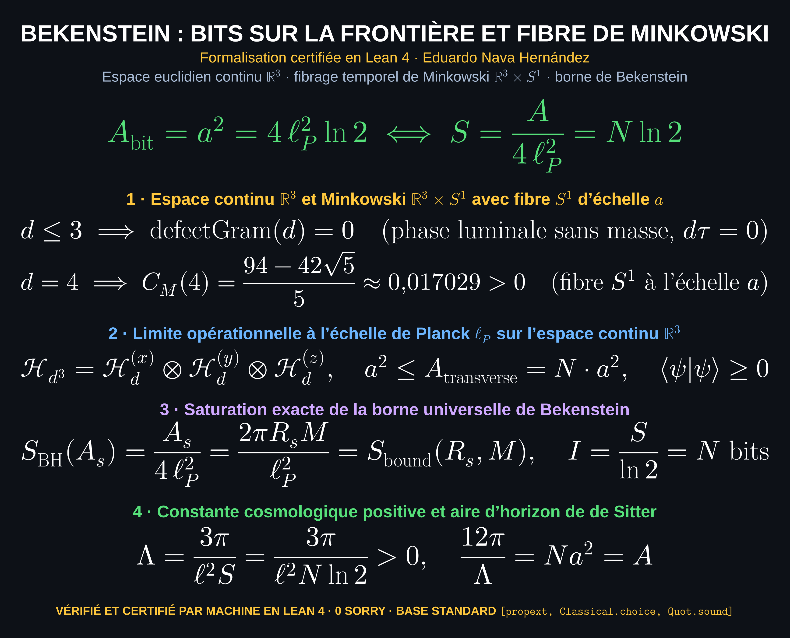

<div align="center">

# RS^N³ · Bekenstein — Bits on the Boundary
### L'entropie d'horizon et la borne universelle lues sur la fibre de Minkowski ℝ³ × S¹

**Eduardo Nava Hernández**  
*Vérification formelle certifiée en Lean 4 · 0 sorry · Mathlib (ZFC)*

[](https://leanprover.github.io/)
[](https://github.com/leanprover-community/mathlib4)
[]()

</div>

---

> ### 🏛️ Les bits de Bekenstein sur la frontière et la fibre de Minkowski
>
> En thermodynamique des trous noirs (Jacob Bekenstein 1972–1973), l'entropie maximale
> d'une région est proportionnelle à l'aire de sa frontière, mesurée en bits d'information :
>
> <div align="center">
> 
> </div>
>
> #### ⚡ L'ÉQUATION PRINCIPALE QUI DÉMONTRE LE THÉORÈME (EN PREMIER LIEU)
>
> L'identité exacte démontrée formellement en Lean 4 établit que l'aire élémentaire requise
> pour héberger un bit de Bekenstein sur une frontière causale coïncide identiquement avec
> l'aire de la fibre temporelle propre de Minkowski `a²` sur la variété `ℝ³ × S¹` :
>
> ```
> A_bit = a² = 4 ℓ_P² log 2   ⟺   S_BH = A / (4 ℓ_P²) = N log 2
> ```
>
> L'entropie de Bekenstein–Hawking n'exige aucune dimension supplémentaire cachée : chaque bit
> d'information sur la frontière occupe exactement l'aire de la fibre temporelle propre `a²`.
>
> #### 🔗 LES ÉQUATIONS NÉCESSAIRES POUR Y PARVENIR (EN SECOND LIEU)
>
> **1 · Espace continu infini ℝ³ et Minkowski ℝ³ × S¹ avec fibre temporelle d'échelle a.**  
> L'espace physique tridimensionnel est l'espace euclidien continu ouvert ℝ³.
> La 4ᵉ dimension est la fibre temporelle propre sur S¹ à l'échelle du générateur `a` :
> * Phase spatiale pure 3D (`d ≤ 3`) : `defectGram(d) = 0`, phase luminale sans masse (`dτ = 0`).
> * Parcours du temps propre (`d = 4`, `dτ > 0`) : active les matrices de Clifford et le défaut
>   irréductible de Szegő `C_M(4) = (94 − 42√5)/5 ≈ 0.017029 > 0`.
> * Positivité hilbertienne : `⟨ψ|ψ⟩ ≥ 0 ⟹ defectGram(d) ≥ 0` (flèche causale stricte).
>
> **2 · Limite opérationnelle à l'échelle de Planck ℓ_P (pas de treillis spatial rigide).**  
> Ce qui est quantifié est la résolution `d` du générateur de transport métrique `(T_d, P_d)`
> sur les trois axes continus indépendants : `ℋ_{d³} = ℋ_d^{(x)} ⊗ ℋ_d^{(y)} ⊗ ℋ_d^{(z)}`.
> La longueur de Planck `ℓ_P` pose la limite opérationnelle inférieure de résolution :
> * Nombre minimal de bits opérationnels : `1 ≤ transverseCount dy dz k`
>   (`transverseCount_pos`).
> * Borne inférieure d'aire opérationnelle : `minkowskiFiberArea lp ≤ transverseArea lp dy dz k`
>   (`operational_area_ge_single_bit`).
> * Quantum minimal atteint : pour `dy = 1, dz = 1, k = 1`, l'aire vaut exactement `a²`
>   (`operational_minimal_area_eq`).
>
> **3 · Saturation exacte de la borne universelle de Bekenstein.**  
> Pour un trou noir de Schwarzschild de rayon `R_s = 2 M`, l'entropie d'horizon de
> Bekenstein–Hawking sature identiquement la borne universelle de Bekenstein :
> `S_BH(schwarzschildArea M) = bekensteinBound (schwarzschildRadius M) M lp = 4 π M² / ℓ_P²`
> (`schwarzschild_saturates_bekenstein_bound`).
> La capacité holographique en bits booléens vaut exactement `N` bits
> (`maxInformationBits_boundaryArea`).
>
> **4 · Constante cosmologique positive et aire d'horizon de de Sitter.**  
> L'entropie des `N` bits de frontière détermine la constante cosmologique de l'espace :
> `cosmologicalConstantBits N ℓ = 3π / (ℓ² N log 2) > 0`
> (`cosmologicalConstantBits_pos`).
> L'aire d'horizon de de Sitter associée coïncide identiquement avec l'aire de frontière `N · a²`
> (`horizonArea_cosmologicalConstantBits`).

---

## Cadre géométrique : espace continu ℝ³ et variété Minkowski ℝ³ × S¹

Dans la physique classique de la gravitation, Jacob Bekenstein (1947–2015, né à Mexico) a
compris que l'information thermodynamique maximale ne remplit pas le volume d'une région, mais
est encodée sur sa frontière à raison d'une fraction d'aire de Planck par bit.

Notre formalisation démontre que ce résultat découle de la géométrie continue fondamentale :
* L'espace euclidien tridimensionnel ℝ³ est ouvert, infini et continu.
* Les observables de transport métrique `(T_d, P_d)` échantillonnent la dynamique sur chaque
  axe avec une résolution hilbertienne `d`.
* Le produit tensoriel `ℋ_{d³} = ℋ_d^{(x)} ⊗ ℋ_d^{(y)} ⊗ ℋ_d^{(z)}` assure la commutation
  des déplacements transverses `[O_X, O_Y] = 0`.
* La variété d'espace-temps est Minkowski `ℝ³ × S¹` :
  * Pour `d ≤ 3`, la phase luminale est sans masse (`defectGram = 0`, `dτ = 0`).
  * Pour `d = 4`, la progression le long de la fibre temporelle propre (`dτ > 0`) active la
    structure spinorielle et le défaut de Szegő `C_M(4) > 0`.
  * La surface minimale d'un bit de Bekenstein sur la frontière est l'aire de cette fibre :
    `a² = 4 ℓ_P² log 2`.

---

## Résultats formels certifiés en Lean 4

### 1. Les bits de frontière et l'aire de la fibre de Minkowski

| Énoncé formel | Déclaration Lean |
|---|---|
| Entropie d'un bit booléen : `log 2 > 0` | `bekensteinBitEntropy_pos` |
| Aire de la fibre de Minkowski : `a² = 4 ℓ_P² log 2 > 0` | `minkowskiFiberArea_pos` |
| Formule explicite de l'entropie de `N` bits : `N · log 2` | `boundaryBitsEntropy_eq_log` |
| Additivité de l'entropie de frontière : `S(N₁ + N₂) = S(N₁) + S(N₂)` | `boundaryBitsEntropy_add` |
| Positivité stricte de l'entropie pour `N ≥ 1` | `boundaryBitsEntropy_pos` |
| Aire géométrique de `N` bits de frontière : `A = N · a²` | `boundaryArea_eq` |
| Positivité stricte de l'aire de frontière | `boundaryArea_pos` |
| **L'aire d'un bit est la fibre de Minkowski** : `A_bit = 4 ℓ_P² log 2` | `bekenstein_bit_area_eq_fiber_area` |
| Bekenstein–Hawking sur l'aire de frontière égale `N · log 2` | `bekenstein_hawking_entropy_eq_bits` |
| Bekenstein–Hawking vérifié si et seulement si `a² = 4 ℓ_P² log 2` | `bekenstein_hawking_iff_bit_area` |

### 2. La borne universelle de Bekenstein et saturation des trous noirs

| Énoncé formel | Déclaration Lean |
|---|---|
| Borne universelle de Bekenstein : `2 π R M / ℓ_P² > 0` | `bekensteinBound_pos` |
| Rayon et aire de l'horizon de Schwarzschild : `16 π M²` | `schwarzschildArea_eq` |
| **Saturation exacte** : `S_BH(A_s) = S_bound(R_s, M)` | `schwarzschild_saturates_bekenstein_bound` |
| Capacité holographique de frontière : `I(Area(N)) = N` bits | `maxInformationBits_boundaryArea` |

### 3. Limite opérationnelle de Planck sur l'espace continu ℝ³

| Énoncé formel | Déclaration Lean |
|---|---|
| Résolution opérationnelle minimale : `1 ≤ transverseCount dy dz k` | `transverseCount_pos` |
| Entropie de la coupe transverse : `(dy · dz · k) · log 2` | `transverseEntropy_eq_log` |
| Positivité de l'entropie opérationnelle | `transverseEntropy_pos` |
| Borne minimale de Planck : `a² ≤ transverseArea lp dy dz k` | `operational_area_ge_single_bit` |
| Quantum minimal atteint à l'unité : aire pour `1 1 1` égale `a²` | `operational_minimal_area_eq` |
| Entropie minimale atteinte à l'unité : entropie pour `1 1 1` égale `log 2` | `operational_minimal_entropy_eq` |

### 4. Constante cosmologique induite par les bits de frontière

| Énoncé formel | Déclaration Lean |
|---|---|
| Formule explicite de `Λ` : `3 π / (ℓ² N log 2)` | `cosmologicalConstantBits_eq` |
| Positivité stricte de la constante cosmologique : `Λ > 0` | `cosmologicalConstantBits_pos` |
| Anti-monotonie stricte : plus de bits donne un plus petit `Λ` | `cosmologicalConstantBits_strictAnti` |
| L'aire d'horizon de de Sitter égale l'aire de frontière `N · a²` | `horizonArea_cosmologicalConstantBits` |

`Verification/Axioms.lean` certifie que l'ensemble des 22 résultats repose exclusivement sur
les axiomes standard de ZFC : `propext`, `Classical.choice` et `Quot.sound`.

---

## Compilation et certification du noyau

Le projet utilise Lean 4 `v4.34.0` et Mathlib `v4.34.0` en mode 100% Mathlib pur.

```bash
lake exe cache get
lake build
lake env lean Verification/Axioms.lean   # uniquement propext, Classical.choice, Quot.sound
```

Spécifications formelles : 0 sorry, aucun axiome ad hoc, `autoImplicit = false`,
lignes de 100 caractères au maximum.

---

## Chronologie 1911–1973

| Année | Événement | Dépôt associé |
|---|---|---|
| 1911 | Premier congrès Solvay : radiation et quanta | |
| 1911–12 | Poincaré : la loi de Planck impose des niveaux discrets | [`nrs3-poincare`](https://github.com/naype888-cloud/nrs3-poincare) |
| 1915–20 | Szegő : théorèmes limites pour matrices de Toeplitz | [Dépôt de base (RS^N, RS^N³)](https://github.com/naype888-cloud/nava-robertson-schrodinger) |
| 1917–27 | Einstein et de Sitter : `Λ` ; Friedmann et Lemaître | [`nrs3-de-sitter`](https://github.com/naype888-cloud/nrs3-de-sitter) |
| 1925–27 | Pauli : exclusion, couches `2n²`, matrices de spin | [`nrs3-pauli-dirac`](https://github.com/naype888-cloud/nrs3-pauli-dirac) |
| 1927 | Relation d'incertitude de Heisenberg ; Solvay | |
| 1928 | Dirac : matrices gamma `4 × 4` | [`nrs3-pauli-dirac`](https://github.com/naype888-cloud/nrs3-pauli-dirac) |
| 1929 | van der Waerden : spineurs, `SL(2, ℂ)` | [`nrs3-uncertainty-cone`](https://github.com/naype888-cloud/nrs3-uncertainty-cone) |
| **1929–30** | **Robertson et Schrödinger : l'inégalité d'incertitude** | **[Dépôt de base (RS^N, RS^N³)](https://github.com/naype888-cloud/nava-robertson-schrodinger)** |
| 1945–46 | Mandelstam–Tamm ; Rao (1945), Cramér (1946) | [`nrs3-mandelstam-tamm-cramer-rao`](https://github.com/naype888-cloud/nrs3-mandelstam-tamm-cramer-rao) |
| 1972–73 | **Bekenstein : entropie des trous noirs et bits sur la frontière** | **[RS^N³ · Bekenstein](https://github.com/naype888-cloud/nrs3-bekenstein)** (ce dépôt) |

---

## La mosaïque des dépôts RS^N³

- [RS^N et RS^N³ — Le théorème de base](https://github.com/naype888-cloud/nava-robertson-schrodinger)
- [RS^N³ · Mandelstam–Tamm et Cramér–Rao](https://github.com/naype888-cloud/nrs3-mandelstam-tamm-cramer-rao)
- [RS^N³ · Landauer et Carnot](https://github.com/naype888-cloud/nrs3-landauer-carnot)
- [RS^N³ · de Sitter](https://github.com/naype888-cloud/nrs3-de-sitter)
- [RS^N³ · Penrose](https://github.com/naype888-cloud/nrs3-penrose) (proposition)
- [RS^N³ · Pauli–Dirac](https://github.com/naype888-cloud/nrs3-pauli-dirac)
- [RS^N³ · Le cône d'incertitude](https://github.com/naype888-cloud/nrs3-uncertainty-cone)
- [RS^N³ · Poincaré](https://github.com/naype888-cloud/nrs3-poincare)
- [RS^N³ · Défaut et courbure](https://github.com/naype888-cloud/nrs3-defect-curvature)
- [RS^N³ · Rovelli — Gravitation Quantique à Boucles](https://github.com/naype888-cloud/nrs3-rovelli-lqg)
- **[RS^N³ · Bekenstein — Bits on the Boundary](https://github.com/naype888-cloud/nrs3-bekenstein)** (ce dépôt)
- [RS^N³ · Dark](https://github.com/naype888-cloud/nrs3-dark)
- [RS^N³ · Cristales](https://github.com/naype888-cloud/nrs3-cristales) (espagnol)

---

## Licence

NRS Noncommercial License 1.0.0, voir [`LICENSE`](LICENSE). Auteur : Eduardo Nava Hernández.
